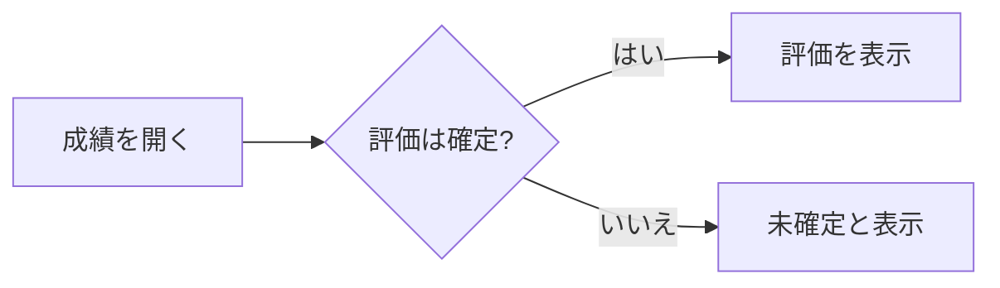
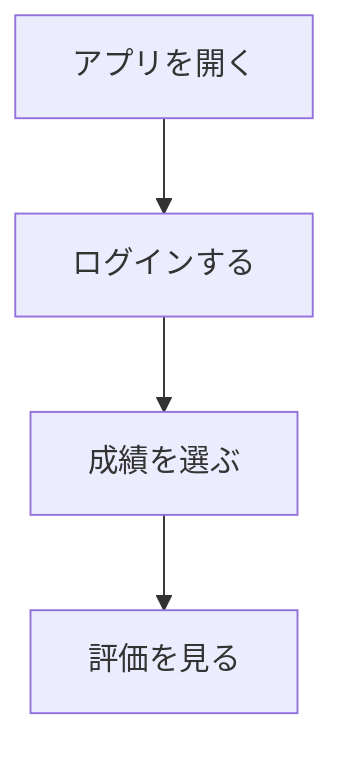
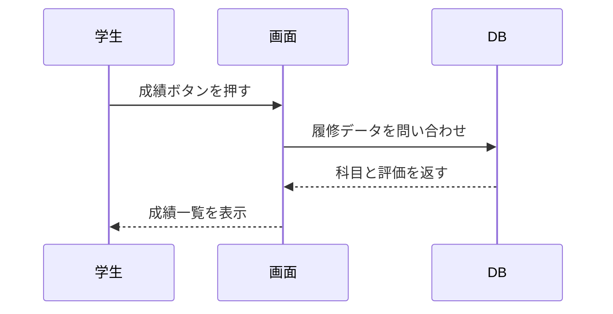

| 項目名 | 型 | 桁数 | 必須 |  
|---|---|---:|:---:|
|学籍番号|文字|5|○|
|科目名|文字|60|○|
|素点|数値|3||

```
26110426
26110434
```

言語名を書くと色がつく

```sql
SELECT FROM 履修
WHERE 評価 IS NULL;
```

チェックリスト  
- [x] 機能一覧を作成する   
- [ ] 非機能要件を書く  
- [ ] レビューを受ける  


# 要件定義書
## 1. 目的
## 2. 対象範囲
## 3. 機能要件
### 3.1 成績確認機能
### 3.2 出欠確認機能
## 4. 非機能要件





